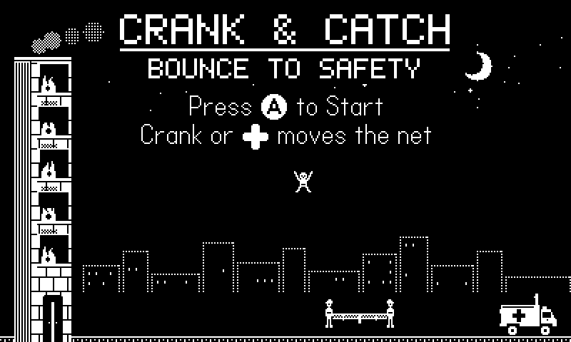
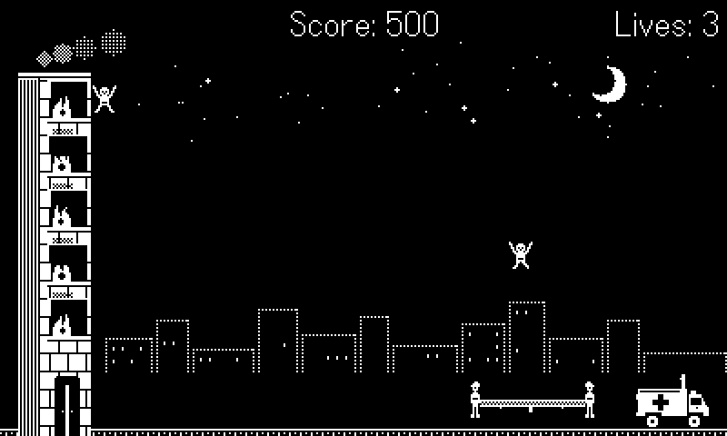

# Crank & Catch

A crank-controlled rescue game for [Playdate](https://play.date). People are jumping from a burning building. Turn the crank to slide two firefighters and their net under each jumper, and bounce them across the street into a waiting ambulance.

| Menu | Gameplay |
|---|---|
|  |  |

## Gameplay

The central mechanic is aiming with the net. Every catch launches the jumper at the same speed; where they land on the net sets the angle:

- **Center:** nearly straight up with a slight forward lean. Safe, slow, and useful for holding one jumper while you deal with another.
- **Right side:** a long throw toward the ambulance. Fewer bounces, more risk.
- **Left side:** back toward the building, which bounces them back into play.

A jumper who reaches the ambulance is rescued. A jumper who hits the ground costs a life.

### Controls

| Input | Action |
|---|---|
| Crank (or D-pad left/right) | Move the net |
| A | Start a game; return to the menu from Game Over |
| B | Pause and resume (opening the Playdate system menu also pauses) |

### Scoring and difficulty

| | |
|---|---|
| Rescue | 100 points, plus 10 for each speed-up in effect (up to 160 at full speed) |
| Express rescue | 2 bounces or fewer: +50 on top |
| Lives | 3 to start; an extra life every 5,000 points, up to 5 |
| Net width | 72 px at the start, 4 px narrower every 500 points, down to 44 px at 3,500 |
| Jumpers at once | 1, then 2 at 500 points, then 3 at 2,000 |
| Game speed | 5% faster every 500 points, up to 1.3x at 3,000; extra jumpers arrive sooner too |

**Fair spawning.** An additional jumper only leaps when a player cranking at a comfortable pace (300 px/s) could reach both its first landing and every other jumper's next landing. Clashes after that come from where the player chose to aim.

The high score is saved on the device. While the menu is showing, the scene plays itself as a demo of the aiming.

## Building

Requires the [Playdate SDK](https://play.date/dev/) (developed against 3.1.2), installed at `~/Developer/PlaydateSDK` or wherever `PLAYDATE_SDK_PATH` points, and a stock `lua` for the tests (`brew install lua`).

```bash
scripts/build.sh          # run all tests, then build build/CrankAndCatch.pdx
scripts/build.sh --run    # as above, then open the build in the Playdate Simulator
scripts/build.sh --test   # tests only; no SDK required
```

## Installing on a Playdate

**Sideloading (recommended).** Download `CrankAndCatch.pdx.zip` from the [latest release](https://github.com/mrballistic/playdate-crank-and-catch/releases/latest), or zip your own build:

```bash
cd build && zip -r CrankAndCatch.pdx.zip CrankAndCatch.pdx
```

Your Playdate must be registered to your play.date account. Upload the zip at [play.date/account/sideload](https://play.date/account/sideload/), then open **Game Library** on the Playdate (on older system software, **Settings > Games**) and refresh if needed; the device downloads it over Wi-Fi.

**USB.** `scripts/install_device.sh` puts a connected Playdate into data-disk mode, copies the game into `/Games` and launches it. The Playdate must be unlocked and connected with a data-capable cable. Computers whose endpoint security blocks USB storage will refuse the disk ("The disk you attached was not readable"); use sideloading on those. Never choose **Initialize** in that dialog: it erases the Playdate's games and saves.

## Testing

Game logic that doesn't touch the Playdate API (configuration, physics, scoring, difficulty, fair spawning) is plain Lua, so it runs under a stock interpreter.

| Command | What it covers |
|---|---|
| `lua tests/run.lua` | Unit and playability tests: every window's jumper is catchable and every aim reaches the ambulance at both the widest and narrowest net, the highest bounce stays on screen, aiming further right never costs bounces, the Express bonus is achievable, and the scoring, net-width, extra-life and fair-spawning rules. |
| `lua tests/smoke.lua` | Runs the real `main.lua` headless against a stubbed Playdate API with a scripted player: menu, attract mode, play, pause, system-menu pause, game over, a second game and a relaunch. |
| `SMOKE_ART=1 lua tests/smoke.lua` | The same run with every image present as a 4-frame sheet: animation behavior, draw order and the background. |

The smoke-test stubs accept any Playdate API call, so they can't catch a misspelled or misused SDK function. Check changes in the simulator as well. (The stubs do mimic one known trap: Playdate sprites own their `width` and `height`, and writes to them are rejected.)

## Tools

| Script | Purpose |
|---|---|
| `scripts/tune.lua` | Sweeps bounce speed and angle settings and reports bounces-to-rescue for each aim. Use it before changing the physics constants. |
| `scripts/fairness.lua` | Simulates the multi-jumper stages at a capped crank speed and reports misses per minute and how many no player could have avoided. `FAIR_OFF=1` gives a baseline without fair spawning. |
| `scripts/screenshots.sh` | Captures screenshots from the simulator. A driver in `scripts/capture/` plays a copy of the game and saves frames at set moments into `screenshots/`, at 400x240 and 800x480. |
| `scripts/video.sh` | Records a 48-second gameplay video from the simulator (same driver, video mode) and encodes it for the web into `site/assets/video/`: MP4 and WebM in Playdate screen tones and pure 1-bit, a native-size variant for overlaying on a device photo, posters and a GIF. Needs ffmpeg. |
| `scripts/site_assets.py` | Builds the web page's static assets into `site/assets/`: screenshots, upscaled art, favicons, a social preview image and a 21:9 banner. |
| `scripts/check_art.py` | Verifies every PNG is strictly 1-bit and that animation sheets divide into whole frames. Run with `uv run --with pillow python scripts/check_art.py`. |
| `scripts/make_title.py` | Crops the title lettering from the launcher card into `source/images/title.png` for the menu. Re-run after changing the card. |
| `scripts/prep_sounds.py` | Converts source audio (MP3, AIFF, M4A) into trimmed 16-bit mono WAVs for the game. |
| `scripts/install_device.sh` | USB install, described above. |

## Project layout

```
source/
  main.lua               State machine, game loop, scoring, spawning, UI
  pdxinfo                Name, bundle ID, version, launcher images
  game/
    config.lua           All layout and tuning constants (pure Lua)
    physics.lua          Motion, catch detection, bounce by hit position (pure Lua)
    rules.lua            Scoring, difficulty, net width, fair spawning (pure Lua)
    assets.lua           Image loading with placeholder fallback; animation helper
    sound.lua            Synthesized effects, overridden by WAVs in source/sounds/
    effects.lua          Score popups and screen shake
    entities/            Building, smoke, firefighters (net), ambulance, jumpers
  images/                1-bit art, including 4-frame animation sheets
  sounds/                Bounce and splat samples
tests/                   Unit, playability and smoke tests
scripts/                 Build, install, tuning, fairness, screenshot and asset tools
screenshots/             Captured from the simulator
site/                    Web page design brief (BRIEF.md) and assets for mrballistic.com/crank-and-catch
docs/                    Art and sound specification; source audio
memory_bank/             Design and implementation notes
```

## Design notes

**Bounce.** With hit position `h` running from -1 (left edge) to +1 (right edge), the launch angle from vertical is `BOUNCE_BIAS_DEG + h * BOUNCE_SPREAD_DEG`, currently 5° ± 15° at 280 px/s. That gives arcs about 98 px high and 1.4 s long. Speed is constant, so the outcome depends only on where the player puts the net. Hit position is measured relative to the net's current width, so aiming means the same thing as the net narrows.

**Overshoots.** The right edge of the screen acts as the ambulance's back door: a throw that overshoots drops in rather than ricocheting back into play.

**Time scaling.** Difficulty speeds up simulation time rather than changing gravity or launch speed. Trajectories keep their shape, so the reachability guarantees verified by the tests hold at every speed.

## Art and audio

All art is original 1-bit pixel art in `source/images/`. The building, firefighters, jumpers and roof smoke are animated with 4-frame sheets. The bounce and splat effects are samples in `source/sounds/`, and other effects are synthesized. Any missing image or sound falls back to a placeholder drawn in code or a synthesized tone, so assets can be replaced one file at a time. Sizes, formats and requirements are in [`docs/art-brief.md`](docs/art-brief.md).

## License

MIT. See [LICENSE.md](LICENSE.md).
